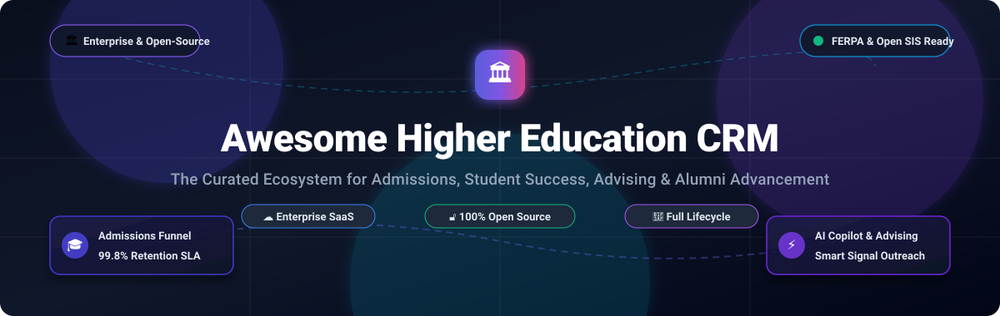

<div align="center">



# 🎓 Awesome Higher Education CRM

### *Curated Directory of Enterprise SaaS Platforms & Open-Source Higher Ed CRM Ecosystems*

<p align="center">
  <a href="https://github.com/ishandutta2007/Awesome-Awesome-Awesome"></a>
  <a href="https://discord.gg/jc4xtF58Ve"></a>
  <a href="https://github.com/ishandutta2007/Awesome-Higher-Education-CRM/stargazers"></a>
  <a href="https://github.com/ishandutta2007/Awesome-Higher-Education-CRM/network/members"></a>
  <a href="https://github.com/ishandutta2007/Awesome-Higher-Education-CRM/blob/main/LICENSE"></a>
  <a href="https://github.com/ishandutta2007/Awesome-Higher-Education-CRM/pulls"></a>
  <a href="https://github.com/ishandutta2007"></a>
</p>

**Tracking the world's premier Customer Relationship Management (CRM) tools, Student Information Systems (SIS), and constituent engagement software engineered specifically for universities, colleges, and higher-education institutions.**

</div>

---

## 📑 Table of Contents

- [📌 Overview & Student Lifecycle](#-overview--student-lifecycle)
- [📊 Sector Overview & Market Dynamics](#-sector-overview--market-dynamics)
- [☁️ SaaS & Hosted Platforms](#️-saas--hosted-platforms)
- [🔓 Open-Source GitHub Projects](#-open-source-github-projects)
- [🏛️ Architectural Stack Recommendation](#️-architectural-stack-recommendation)
- [🤝 How to Contribute](#-how-to-contribute)
- [📈 Star History](#-star-history)
- [💖 Support & Sponsorship](#-support--sponsorship)
- [📜 Disclaimer & Compliance](#-disclaimer--compliance)

---

## 📌 Overview & Student Lifecycle

Higher education institutions face unique constituent relationship dynamics. Unlike conventional B2B sales pipelines, a university must manage complex relationships across a multi-stage **constituent lifecycle**:

1. **Recruitment & Prospective Inquiries**: High-velocity marketing, high school outreach, event visit management, automated SMS/WhatsApp/email drip campaigns.
2. **Admissions & Application Review**: Document verification, transcript processing, portfolio grading, holistic application committee review, enrollment deposits.
3. **Student Success & Academic Advising**: Early warning risk signals, degree audit progression, tutoring appointment scheduling, retention interventions.
4. **Alumni Relations & Philanthropic Advancement**: Capital campaign fundraising, endowment pledge tracking, alumni mentorship networks, donor reunions.

This repository tracks both industry-standard **enterprise SaaS vendors** and self-hosted **open-source alternatives** enabling full institutional data sovereignty, FERPA compliance, and freedom from per-seat license escalations.

---

## 📊 Sector Overview & Market Dynamics

* **Estimated Market Size**: The global Higher Education CRM software market was valued at **$2.28 billion in 2024** and is projected to expand to **$5.45 billion by 2032**, demonstrating a Compound Annual Growth Rate (CAGR) of **~11.8%**. Market acceleration is catalyzed by demographic shifts ("the enrollment cliff"), cross-channel student communication demands, and rapid integration of generative AI advising agents.
* **Market Dynamics & Structure**: The sector is **moderately concentrated with a bifurcated competitive landscape**:
  * *High-End Admissions & Enterprise Consolidation (Concentrated)*: The admissions and application management tier exhibits strong incumbent concentration, dominated by **Slate by Technolutions** (powering over 1,800 colleges and the majority of top-tier US admissions offices) and **Salesforce Education Cloud** (the standard for campus-wide IT consolidation).
  * *Full-Lifecycle, Community Colleges & Niche Stages (Fragmented)*: In student retention, alumni advancement, and community college enrollment, the market is moderately fragmented. Specialized innovators like **Element451**, **LeadSquared**, and **Ellucian CRM Advance** compete actively with modern open-source ERP/CRM platforms (**Twenty**, **CiviCRM**, **OpenEduCat**, **Frappe Education**) chosen by universities seeking transparent constituent records and on-premise governance.

---

## ☁️ SaaS & Hosted Platforms

The table below lists leading commercial SaaS platforms designed for higher education, sorted in **descending order by company size, market valuation, or annual revenue**.

| Platform | Key Focus & Lifecycle Stage | Company Size / Valuation / Revenue | Starting Pricing | Free Tier / Trial Limit |
| :--- | :--- | :--- | :--- | :--- |
| [**Salesforce Education Cloud**](https://www.salesforce.com/solutions/industries/education/) | Full enterprise student lifecycle (Recruitment, Admissions, Student Success, Advancement) | **~$300 Billion Market Cap**<br>*(FY25 Revenue: ~$35 Billion)* | **$350 / user / month**<br>*(Enterprise Edition, billed annually)*; $525/user/month for Unlimited Edition | **30-day full-featured free trial** with pre-configured higher-ed data models; no credit card required |
| [**HubSpot for Higher Education**](https://www.hubspot.com/) | Inbound enrollment marketing, prospective lead capture, admissions pipeline tracking | **~$30 Billion Market Cap**<br>*(FY24 Revenue: ~$2.6 Billion)* | **$20 / month** ($240/yr for Starter Tier); Free Enterprise portal for professors via EPP | **Free forever tier** (2 users, 1,000 contacts, 1 deal pipeline, 2,000 email sends/month); 14-day free trial on Pro |
| [**Ellucian CRM Advance**](https://www.ellucian.com/solutions/ellucian-crm-advance) | Higher education fundraising, donor campaign tracking, native Banner & Colleague SIS integration | **~$5.0 Billion Valuation**<br>*(Vista & Blackstone; Revenue: ~$1.1B)* | **~$50,000 / year base fee**<br>*(Scaled by active donor/constituent database volume + implementation)* | **No free tier or trial**; institutional guided live sandbox demonstration available upon enterprise RFP consultation |
| [**Blackbaud Raiser's Edge NXT**](https://www.blackbaud.com/products/blackbaud-raisers-edge-nxt) | University advancement, donor pledge management, alumni gift stewardship | **~$4.2 Billion Market Cap**<br>*(NASDAQ: BLKB; Revenue: ~$1.15B)* | **$4,000 – $10,000 / year base**<br>*(Standard constituent tier; higher-ed suites start ~$12,000/user/yr)* | **No free tier or self-serve trial**; customized live interactive institutional walkthrough provided on sales request |
| [**LeadSquared for Higher Ed**](https://www.leadsquared.com/industries/higher-education-crm/) | High-velocity student inquiry capture, multi-channel messaging (WhatsApp/SMS), counselor tracking | **$1.0 Billion Valuation**<br>*(Unicorn; ARR: ~$40 Million+)* | **$25 / user / month**<br>*(Lite CRM, billed annually)* or $400/month team base subscription | **No self-serve free trial**; personalized admissions workflow demo and proof-of-concept sandbox upon request |
| [**Liaison CAS & TargetX**](https://www.liaisonedu.com/) | Centralized Application Service (CAS), Salesforce-native recruitment, applicant reviews, retention | **~$800 Million Valuation**<br>*(Meritage Group; Revenue: ~$120M+)* | **~$20,000 / year base**<br>*(TargetX Recruitment); CAS starts ~$15,000/yr + applicant processing fees* | **No free tier or trial**; institutional consultation, RFP evaluation, and custom sandbox walkthrough available |
| [**Anthology Reach**](https://www.anthology.com/products/reach) | Microsoft Dynamics-based recruitment, admissions workflows, student retention, campus engagement | **~$500 Million Scale**<br>*(Encoura / Leeds Equity; Revenue: ~$150M+)* | **~$25,000 / year base**<br>*(Tiered by undergraduate/graduate FTE enrollment count + cloud hosting)* | **No free tier or trial**; guided institutional architecture review and live demo via enterprise sales team |
| [**Slate by Technolutions**](https://technolutions.com/) | Admissions funnel dominant platform, application reading committee, communication automation | **~$150 Million+ Valuation**<br>*(Bootstrapped; ARR: ~$80M–$100M; 1,800+ campuses)* | **$30,000 / year flat fee**<br>*(Under 1,500 applications/yr)*; $50,000/year (1,500–7,500 applications) | **No free tier or self-serve trial**; live Sandbox environment demonstration and consultation for vetted institutions |
| [**Jenzabar SONIS & One**](https://www.jenzabar.com/product/jenzabar-sonis) | Cloud-native SIS and CRM suite tailored for specialized schools, community colleges, and mid-sized institutions | **~$150M – $250M Valuation**<br>*(Privately held; Revenue: ~$115M)* | **~$15,000 – $25,000 / year**<br>*(Starting base subscription for Jenzabar SONIS modular platform)* | **No free tier or self-serve trial**; interactive live software demonstration and institutional quote scoping upon request |
| [**Element451**](https://element451.com/) | AI-native student engagement, Bolt AI conversational agents, personalized recruitment workflows | **$175 Million Investment**<br>*(PSG Equity; ARR: ~$12 Million; 350+ campuses)* | **~$20,000 / year base fee**<br>*(Annual contract based on student FTE; community college discount tiers)* | **No free tier or trial**; live AI agent demonstration and custom institutional test sandbox arranged upon consultation |
| [**Full Fabric**](https://www.fullfabric.com/) | European-designed higher ed admissions, applicant portal, modular SIS, program operations | **~$10M – $15M Valuation**<br>*(Privately held; ARR: ~$2.3 Million)* | **€12,000 / year flat base**<br>*(Approx. $13,000/yr for core platform)* + progressive applicant volume fee | **No free tier or open trial**; structured guided platform walkthrough and pricing proposal upon institutional request |

---

## 🔓 Open-Source GitHub Projects

Open-source solutions empower universities and colleges to retain full data sovereignty under FERPA/GDPR, eliminate recurring per-student pricing models, and customize enrollment and alumni workflows.

The repositories below are **sorted in descending order by GitHub star count**. Each star badge links directly to the project's stargazers page.

| Project Name | GitHub Stars | Core Architecture | Focus & Capabilities | License |
| :--- | :---: | :--- | :--- | :---: |
| [**Twenty**](https://github.com/twentyhq/twenty) | [](https://github.com/twentyhq/twenty/stargazers) | TypeScript, React, NestJS, PostgreSQL | Modern open-source CRM with custom objects, metadata engine, and API-first pipelines; adaptable for university constituent tracking. | AGPL-3.0 |
| [**erxes**](https://github.com/erxes/erxes) | [](https://github.com/erxes/erxes/stargazers) | Node.js, React, GraphQL, MongoDB | Open-source constituent experience and CRM suite; features omni-channel messaging, admissions intake forms, and team inboxes. | AGPL-3.0 |
| [**EspoCRM**](https://github.com/espocrm/espocrm) | [](https://github.com/espocrm/espocrm/stargazers) | PHP, Backbone.js, MySQL/MariaDB | Lightweight, highly configurable web CRM; extensively deployed for student inquiry tracking, applicant portals, and advising notes. | GPL-3.0 |
| [**OpenEduCat CE**](https://github.com/openeducat/openeducat_erp) | [](https://github.com/openeducat/openeducat_erp/stargazers) | Python, Odoo Framework, PostgreSQL | Comprehensive educational ERP & CRM: admissions, student registry, fees, course scheduling, exams, attendance, and alumni tracking. | LGPL-3.0 |
| [**CiviCRM Core**](https://github.com/civicrm/civicrm-core) | [](https://github.com/civicrm/civicrm-core/stargazers) | PHP, MySQL, Drupal / WordPress / Joomla | The premier open-source CRM for nonprofits & universities; engineered for donor campaigns, capital gifts, alumni events, and mailings. | AGPL-3.0 |
| [**Frappe Education**](https://github.com/frappe/education) | [](https://github.com/frappe/education/stargazers) | Python, Frappe Framework, Vue.js, MariaDB | Full-featured student information system built on ERPNext; manages applicant admissions, student portals, course rosters, and billing. | GPL-3.0 |
| [**RosarioSIS**](https://github.com/francoisjacquet/rosariosis) | [](https://github.com/francoisjacquet/rosariosis/stargazers) | PHP, PostgreSQL | Proven open-source SIS powering educational institutions: student demographics, enrollment, attendance, grading, transcripts, and fees. | GPL-2.0 |
| [**Gibbon Core**](https://github.com/GibbonEdu/core) | [](https://github.com/GibbonEdu/core/stargazers) | PHP, MySQL | Flexible open-source school and college administration system; manages student profiles, admissions records, timetables, and assessments. | GPL-3.0 |
| [**openSIS Classic**](https://github.com/OS4ED/openSIS-Classic) | [](https://github.com/OS4ED/openSIS-Classic/stargazers) | PHP, MySQL | Commercial-grade, secure, scalable student information system handling transcripts, graduation progress, staff data, and gradebooks. | GPL |
| [**Advising App**](https://github.com/canyongbs/advisingapp) | [](https://github.com/canyongbs/advisingapp/stargazers) | PHP, Laravel TALL Stack, MySQL | AI-assisted staff conversational assistant, student retention platform, and higher-ed recruitment CRM with population segmentation. | Elastic-2.0 |
| [**FenixEdu Academic**](https://github.com/FenixEdu/fenixedu-academic) | [](https://github.com/FenixEdu/fenixedu-academic/stargazers) | Java, FenixFramework, MySQL | Enterprise academic management platform built for major European universities; handles student registration, degrees, and curricula. | LGPL-3.0 |
| [**AlumNet**](https://github.com/jungang/alumnet) | [](https://github.com/jungang/alumnet/stargazers) | Vue 3, Node.js, PostgreSQL, Qdrant | AI-powered school history exhibition kiosk and alumni database with natural-language Q&A and vector semantic search. | MIT |
| [**OSUMS**](https://github.com/hrshadhin/osums) | [](https://github.com/hrshadhin/osums/stargazers) | PHP, Laravel, MySQL | Open Source University Management System: student course enrollment, faculty allocation, department tracking, and examination rosters. | MIT |
| [**University Management System**](https://github.com/kunaltyagi9/University-Management-System) | [](https://github.com/kunaltyagi9/University-Management-System/stargazers) | Java, Swing, MySQL | Desktop/client-server university administration platform for managing student fees, teacher assignments, and exam records. | Apache-2.0 |
| [**Collejo**](https://github.com/CodeBreez/collejo) | [](https://github.com/CodeBreez/collejo/stargazers) | PHP, Laravel, Vue.js, MySQL | Clean school and university management platform featuring student grades, class management, attendance logs, and role permissions. | GPL-3.0 |
| [**eduTrac SIS**](https://github.com/nomadicjosh/eduTrac-SIS) | [](https://github.com/nomadicjosh/eduTrac-SIS/stargazers) | PHP, MySQL | Open-source SIS specifically tailored for post-secondary and higher-education institutions; handles transcripts and student files. | GPL-3.0 |
| [**OpenEMIS Core**](https://github.com/OpenEMIS/core) | [](https://github.com/OpenEMIS/core/stargazers) | PHP, CakePHP, MySQL | UNESCO-endorsed Education Management Information System for tracking institutional records, academic staff, and student demographics. | GPL-3.0 |
| [**Alumni Management System**](https://github.com/cris-ronaldo7/Alumni-Management-System) | [](https://github.com/cris-ronaldo7/Alumni-Management-System/stargazers) | PHP, MySQL, Bootstrap | Web-based alumni registry managing graduate communication, career updates, donation campaigns, and university alumni events. | MIT |
| [**StudentGraphQLTS**](https://github.com/BaseMax/StudentGraphQLTS) | [](https://github.com/BaseMax/StudentGraphQLTS/stargazers) | TypeScript, NestJS, Apollo GraphQL, PostgreSQL | GraphQL university backend managing advisor-student interactions, dissertation approvals, seminar sign-ups, and graduation queries. | GPL-3.0 |
| [**Alumni Network**](https://github.com/tripathi-khushi/Alumni-Network) | [](https://github.com/tripathi-khushi/Alumni-Network/stargazers) | React, Node.js, Express, MongoDB | Mentorship matching network connecting alumni with students, featuring role profiles, messaging threads, and event RSVP trackers. | MIT |
| [**Alumni Management & Transcript System**](https://github.com/aniket-thapa/alumni-management-and-transcript-generation-system) | [](https://github.com/aniket-thapa/alumni-management-and-transcript-generation-system/stargazers) | Node.js, Express, EJS, MySQL | Graduate record directory with built-in automated student transcript PDF generation and administrative approval workflows. | MIT |

---

## 🏛️ Architectural Stack Recommendation

For IT teams seeking to build a completely self-hosted, modular, and vendor-lock-in-free Higher Education CRM and student administration stack:

```
┌─────────────────────────────────────────────────────────────────┐
│                      STUDENT LIFE CYCLE CRM                     │
├───────────────────────────────┬─────────────────────────────────┤
│  Recruitment & Inquiry CRM    │  Twenty / EspoCRM / erxes       │
│  Admissions & Student Portal  │  Frappe Education / OpenEduCat  │
│  Academic Records & SIS Core  │  RosarioSIS / openSIS / Gibbon  │
│  Advising & Early Risk Alert  │  Advising App (Canyon GBS)      │
│  Advancement & Alumni Network │  CiviCRM Core / AlumNet         │
└───────────────────────────────┴─────────────────────────────────┘
```

* **Recruitment & Intake**: Deploy [Twenty](https://github.com/twentyhq/twenty) or [EspoCRM](https://github.com/espocrm/espocrm) to ingest website inquiries, automate counselor assignments, and manage visit registrations.
* **Core Academic Records (SIS)**: Utilize [RosarioSIS](https://github.com/francoisjacquet/rosariosis) or [openSIS Classic](https://github.com/OS4ED/openSIS-Classic) for FERPA-compliant course registration, grading, and transcripts.
* **Student Retention & Advising**: Implement [Advising App](https://github.com/canyongbs/advisingapp) to empower academic counselors with AI-drafted interventions and multi-channel student outreach.
* **Philanthropic Advancement**: Utilize [CiviCRM](https://github.com/civicrm/civicrm-core) for donor management, fundraising campaigns, and alumni relations.

---

## 🤝 How to Contribute

Contributions from institutional practitioners, higher-ed administrators, and open-source software developers are warmly welcome!

1. 🍴 **Fork the repository** on GitHub.
2. 🌿 **Create a feature branch**: `git checkout -b feature/add-new-crm-platform`
3. 📝 **Add or update entries**: Follow the existing tabular structure, ensuring specific starting pricing, explicit free trial limits, and exact GitHub star counts.
4. 🔍 **Verify links and metrics**: Ensure official links and repository URLs are active and factual.
5. 🚀 **Submit a Pull Request**: Detail your changes in the PR description.

---

## 📈 Star History

[](https://star-history.dera.page/#ishandutta2007/Awesome-Higher-Education-CRM&type=date&legend=top-left)

---

## 💖 Support & Sponsorship

Thank you for exploring and utilizing **Awesome Higher Education CRM**! Maintaining this comprehensive ecosystem guide takes dedicated research and continuous updates.

If this repository has provided value to your research, institution, or project:
* ⭐ **Star the repository** to increase its visibility across the higher education community.
* 🍴 **Fork and share** with colleagues, admissions teams, and academic IT departments.
* ☕ **Support the maintainer**: Buy a coffee or become a sponsor via the [GitHub Sponsor Dashboard](https://github.com/sponsors/ishandutta2007).

<div align="center">

<a href="https://github.com/sponsors/ishandutta2007">
  
</a>

</div>

---

## 📜 Disclaimer & Compliance

* This list is a **community-curated directory** intended for educational and technological evaluation. Inclusion does not constitute a formal commercial endorsement.
* Educational software deployments must comply with relevant data privacy frameworks, including the **Family Educational Rights and Privacy Act (FERPA)**, the **General Data Protection Regulation (GDPR)**, and institutional security controls.
* Commercial pricing figures and trial terms reflect publicly documented market data and vendor benchmarks as of 2026; prospective institutions should consult vendors directly for binding contractual quotes.

---

<div align="center">
  <sub>Built with ❤️ for enrollment directors, student success deans, advancement officers, and higher-ed developers worldwide.</sub>
</div>
